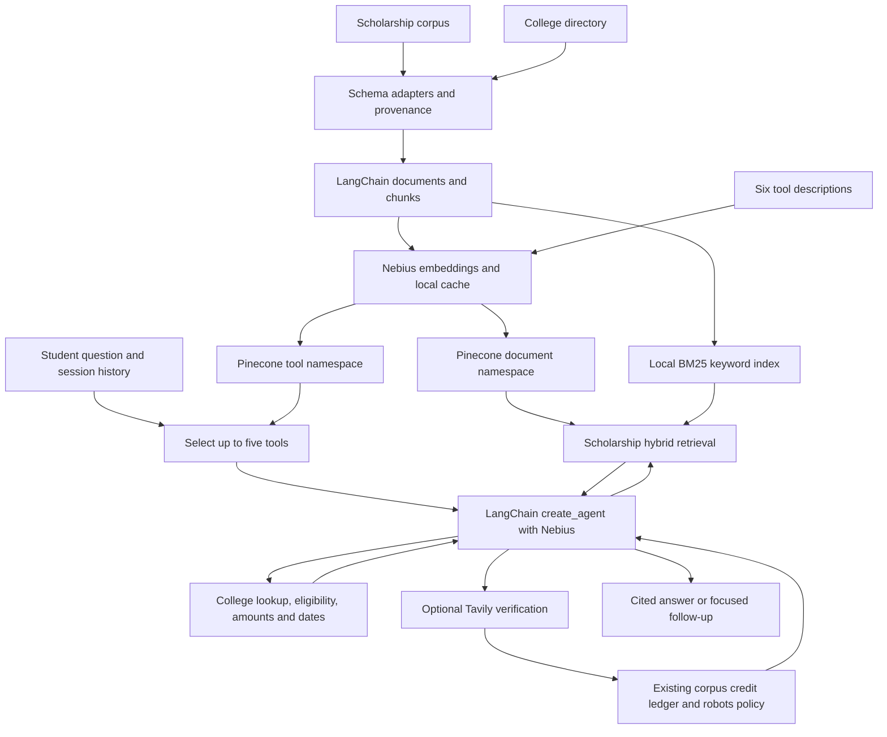

# Agentic scholarship Q&A architecture

TOP_K=5 selects tools, while RETRIEVAL_K=5 selects evidence chunks. These are independent operations and namespaces.

Hybrid search uses reciprocal-rank fusion of Pinecone cosine dense matches and local BM25 results. Metadata record-type filters keep college directory text out of scholarship evidence. Full program records accompany retrieved chunks so a deadline or eligibility field split across chunks can still be inspected.

Structured college lookup uses exact UNITIDs/names then candidates; it does not infer scholarship links. Scholarship pages stay distinct: grouping pages into one program requires additional reviewed identifiers. No relationship between colleges and scholarships is invented.

Live verification is optional and constrained to known corpus URLs. It invokes the existing stem_corpus.py budget guard with its existing output folder and ledger. It does not bypass the original 900-credit total. Known corpus URLs are not independently certified official sources; review provenance before trusting them.

Agent tools return untrusted evidence. The system prompt requires citations, careful eligibility screening and abstention. Prompt instructions alone cannot guarantee semantic accuracy; use the evaluation harness and human checks before relying on results.
